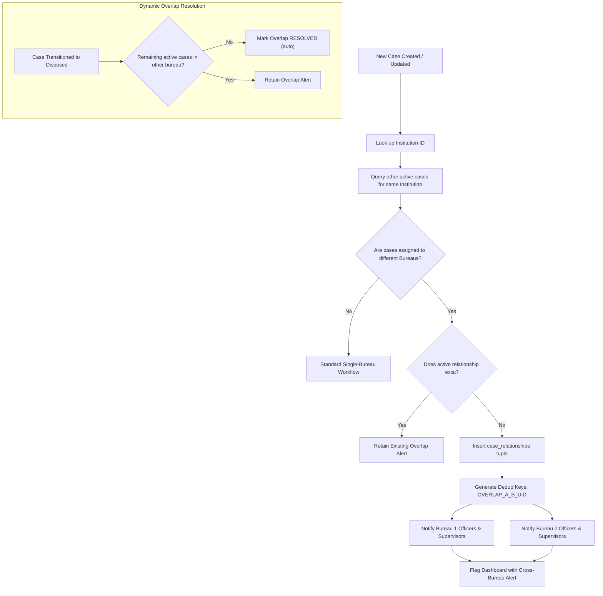
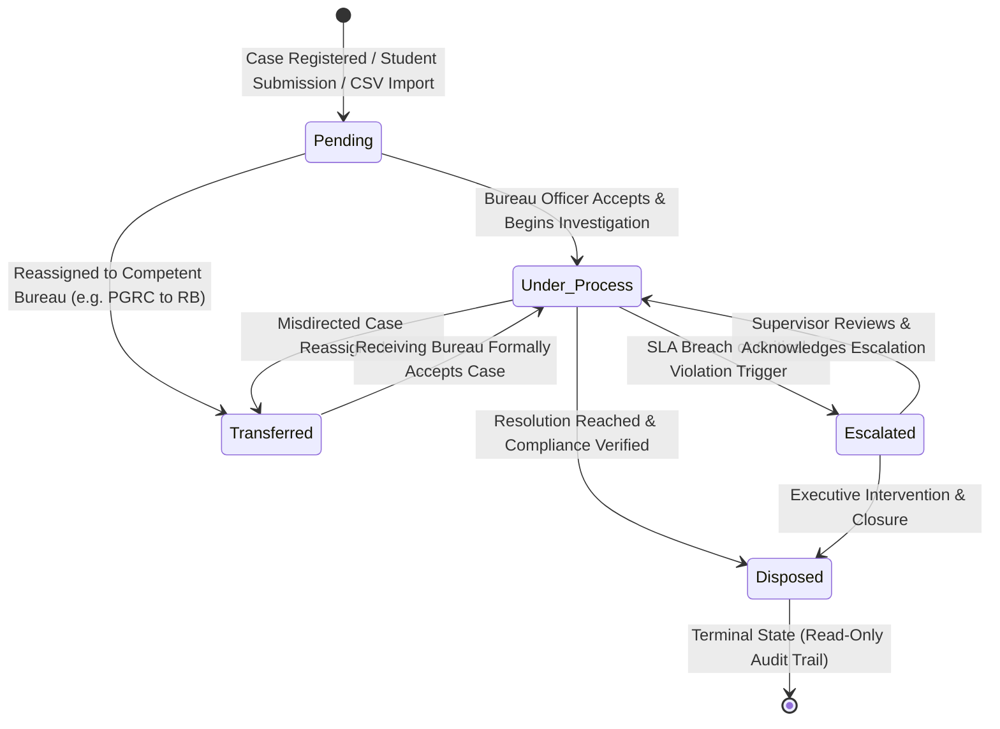
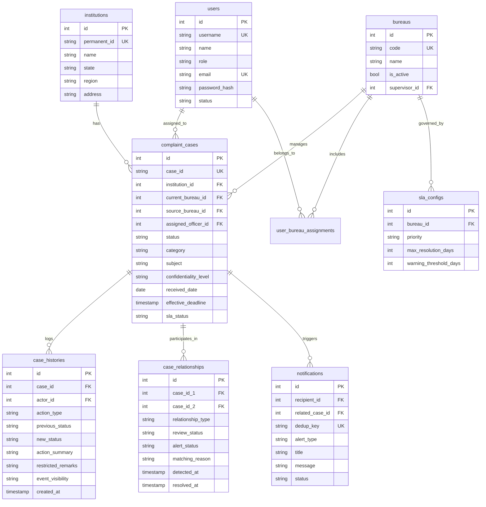

# EduVoice — Technical Approach & System Architecture
**Problem Statement SIH26264: Integrated Dashboard for Monitoring and Tracking Institution-Related Complaint Cases Across AICTE Bureaus/Cells**

---

## 1. Executive Summary & Problem Statement

Technical institutions in India operate under the regulatory umbrella of the **All India Council for Technical Education (AICTE)**. Grievances and compliance complaints originate from multiple independent channels (National PGRC portal, Regional Bureau inspections, Approval Bureau compliance filings, vigilance reports, and direct institutional feedback).

Historically, these complaints operated in **isolated operational silos**:
- An institution facing severe infrastructural deficiencies in the **Regional Bureau (RB)** might concurrently be under investigation for capitation fee extortion by the **Public Grievance Redressal Cell (PGRC)**.
- Neither bureau had cross-visibility into parallel proceedings, creating compliance blind spots, duplicate investigations, and inconsistent regulatory actions.
- Complainants feared institutional retaliation due to insufficient cryptographic identity protection.

**EduVoice** resolves SIH26264 by establishing a unified, multi-tenant, cloud-native monitoring and tracking platform featuring:
1. **Automated Cross-Bureau Overlap Detection**: Synchronously surfaces parallel cases involving the same institution across distinct AICTE bureaus.
2. **Deterministic 5-Stage Complaint Lifecycle**: Concurrency-safe transitions (`Pending` ➔ `Under Process` ➔ `Transferred` ➔ `Escalated` ➔ `Disposed`) backed by immutable event audits.
3. **Dual-Track Privacy & Anonymity**: Cryptographic blind tokens (Ed25519) for student institutional feedback alongside two-tier confidentiality (`ORDINARY` vs `HIGH`) for sensitive whistleblowing and anti-ragging cases.
4. **Dynamic SLA & Escalation Engine**: Real-time disposal monitoring, ageing buckets, and automated supervisory escalation triggers.

---

## 2. End-to-End System Architecture

EduVoice is architected as a modern, decoupled cloud application deployed across **Vercel Global Edge** and **Supabase Managed PostgreSQL**:

```mermaid
flowchart TD
    subgraph Clients["User Personas & Client Layer"]
        C_Admin["Central AICTE Admin"]
        C_Officer["Bureau Officers (PGRC, RB, AB)"]
        C_Supervisor["Regional Supervisors"]
        C_Auditor["Compliance Auditors"]
        C_Student["Students & Complainants"]
    end

    subgraph Vercel_Edge["Vercel Global Edge Network (Reverse Proxy & CDN)"]
        FE["Next.js 14 Frontend App<br/>(eduvoice-frontend.vercel.app)"]
        FE_Static["Static Assets & React Components"]
        FE_Rewrites["Next.js /api/* Rewrite Proxy"]
    end

    subgraph Vercel_Serverless["Vercel Serverless Compute (AWS Lambda)"]
        BE["FastAPI ASGI Engine<br/>(eduvoice-backend.vercel.app)"]
        subgraph Middleware_Pipeline["Security & Routing Pipeline"]
            MW_Prefix["PathPrefixMiddleware (Vercel Normalizer)"]
            MW_Sec["SecurityHeaders (CSP, HSTS, X-Frame)"]
            MW_CORS["CORS & Session Cookie Handler"]
        end
        subgraph Core_Services["Domain Service Layer"]
            SVC_Auth["Auth & RBAC Service (Argon2id + JWT)"]
            SVC_Case["Case Allocation (AICTE/YYYY/NNNNNN)"]
            SVC_Overlap["Cross-Bureau Overlap Engine"]
            SVC_SLA["SLA & Ageing Calculation Engine"]
            SVC_Vis["Visibility & Confidentiality Filter"]
            SVC_Blind["Ed25519 Blind Signature Issuance"]
        end
    end

    subgraph Supabase_Cloud["Supabase Managed Cloud (AWS ap-south-1)"]
        Pooler["Supavisor Transaction Pooler<br/>(Port 6543 - PgBouncer)"]
        subgraph Postgres_Storage["PostgreSQL Relational Engine (23 Tables)"]
            DB_Inst["institutions"]
            DB_Cases["complaint_cases"]
            DB_Hist["case_histories (Immutable)"]
            DB_Rel["case_relationships (Overlaps)"]
            DB_Notif["notifications (Queue)"]
            DB_SLA["sla_configs"]
            DB_Users["users & user_bureau_assignments"]
            DB_Tokens["spent_tokens & email_tokens"]
        end
    end

    Clients -->|HTTPS / TLS 1.3| FE
    FE --> FE_Static
    FE -->|/api/* Calls| FE_Rewrites
    FE_Rewrites -->|Internal Encrypted Mesh| MW_Prefix
    MW_Prefix --> MW_Sec --> MW_CORS --> BE
    BE --> Core_Services
    Core_Services -->|SQLAlchemy 2.0 (NullPool)| Pooler
    Pooler --> Postgres_Storage
```

---

## 3. Core Architectural Modules & Technical Approach

### 3.1. Concurrency-Safe Annual Identifier Allocation
Case numbers adhere to the official AICTE format:
$$\text{AICTE} / \text{YYYY} / \text{NNNNNN}$$
(e.g., `AICTE/2026/000014`).
- **Technical Implementation**: Managed via the table `case_number_sequences` using atomic `UPDATE ... RETURNING last_number` operations under serializable transactions.
- Prevents sequence gaps and race conditions when concurrent filings occur across multiple bureaus or bulk CSV imports.

### 3.2. Cross-Bureau Overlap Detection Algorithm
When any case is created, transitioned, or imported:
1. The engine queries for any open cases associated with the same `institution_id` where:
   $$\text{current\_bureau\_id} \neq \text{new\_case.bureau\_id} \quad \text{and} \quad \text{status} \neq \text{'Disposed'}$$
2. An undirected relationship tuple $(\min(id_1, id_2), \max(id_1, id_2))$ is generated.
3. If an active relationship record exists, its status is verified. If absent, a new `case_relationships` row with `relationship_type = 'CROSS_BUREAU_OVERLAP'` is created.
4. Targeted notifications with deduplication keys (`OVERLAP_{id1}_{id2}_{user_id}`) are dispatched into the notification queues of officers and supervisors in both participating bureaus.
5. If one case is subsequently disposed or moved to the same bureau, the overlap automatically transitions to `RESOLVED` with an immutable resolution timestamp.



---

## 4. Complaint Lifecycle State Machine

The case progression conforms to a strict deterministic finite state automaton:



### State Transition Rules:
- **`Pending`**: Case lodged; SLA clock starts; initial automatic overlap check executes.
- **`Under Process`**: Investigating officer assigned; evidence collection active.
- **`Transferred`**: Destination bureau receives alert; case enters receiving review queue.
- **`Escalated`**: Triggered automatically when threshold $\ge 30\text{ days}$ without action, or manually by a supervisor; central administrators notified.
- **`Disposed`**: Terminal; requires formal resolution summary affidavit; triggers auto-resolution of dependent overlap alerts.

---

## 5. Database Schema & Entity Relationships

The PostgreSQL database comprises **23 normalized relational tables** engineered for referential integrity:



---

## 6. Security, Privacy & Confidentiality Architecture

### 6.1. Two-Tier Confidentiality Model
- **`ORDINARY`**: General compliance, infrastructure, and fee disputes. Metadata, bureau assignments, and anonymized subjects are visible across bureaus for overlap detection.
- **`HIGH`**: Whistleblower corruption disclosures, sexual harassment (ICC), and anti-ragging filings.
  - Case descriptions and complainant identities are strictly masked from other bureaus.
  - In cross-bureau overlap listings, cross-bureau officers see `[RESTRICTED]` for the subject to maintain awareness of institutional scrutiny without exposing protected case particulars.

### 6.2. Cryptographic Anonymous Student Feedback (Ed25519 Blind Tokens)
For campus-level teacher and institutional reviews:
1. The student proves course enrollment to obtain an **Ed25519 blind signature** over an blinded token.
2. The server signs the token without knowing its value or correlating it with student identity.
3. The student unblinds the token and submits course feedback via a decoupled anonymous channel.
4. The server validates the cryptographic signature and checks the `spent_tokens` table to prevent double-voting, achieving **cryptographic unlikability**.

### 6.3. Serverless Database Connection Hardening
- **Pool Exhaustion Prevention**: Serverless function containers spin up and down dynamically. Using direct connection pools causes database socket exhaustion (`Too many connections`).
- **NullPool Engine**: FastAPI initializes SQLAlchemy with `poolclass=NullPool`, terminating client connections at the end of each request while relying on Supabase's **Supavisor (PgBouncer)** transaction pooler on port `6543`.
- **Query Parameter Sanitization**: All incoming database strings pass through `clean_postgres_url()`, stripping non-libpq query parameters (`supa`, `pgbouncer`) to preserve pure wire-protocol compatibility.

---

## 7. Technology Stack Summary

| Layer | Component | Technology / Library | Architectural Role |
|---|---|---|---|
| **Frontend** | Framework | **Next.js 14 (App Router)** | Server-rendered portal, dynamic UI, React Server Components |
| | Styling | **TailwindCSS** | High-density dashboard design, accessible tables, status badges |
| | Reverse Proxy | **Next.js Rewrites (`next.config.mjs`)** | `/api/*` same-site proxying ensuring zero cookie leakage |
| **Backend** | Framework | **FastAPI (ASGI Serverless)** | High-throughput asynchronous REST API |
| | Runtime | **Python 3.12 / 3.13** | Vercel Python Serverless Function (`api/index.py`) |
| | Validation | **Pydantic v2 & Pydantic-Settings** | Strict runtime schema parsing & env variable guards |
| | Security | **Argon2id + PyJWT + Cryptography** | Salted password hashing, JWT cookies, Ed25519 signatures |
| **Database** | Database Engine | **PostgreSQL 15+** | Relational data persistence with strict foreign key constraints |
| | Host | **Supabase Managed Cloud** | Hosted on AWS `ap-south-1` (Mumbai) |
| | ORM | **SQLAlchemy 2.0 (Mapped)** | Modern declarative relational mapping |
| | Driver | **Psycopg 3 (`psycopg[binary]`)** | Modern binary PostgreSQL wire-protocol driver |
| | Connection Pool | **Supavisor (PgBouncer)** | Transaction pooler running on port `6543` |
| **DevOps / CI** | Git & Repository | **GitHub (`jivi001/EduVoice`)** | Monorepo source control |
| | Deployment | **Vercel** | Split monorepo deployments (`frontend` + `backend`) |
